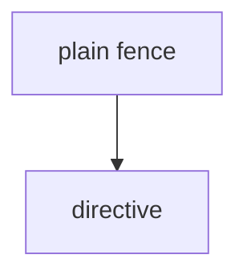

# Usage

A second page so the sidebar, the toctree and the GitHub edit link have
something to render.

```{mermaid}
graph LR
  A[config] --> B[URDF]
```

The same diagram as a plain fence, the form GitHub and editor previews draw:


